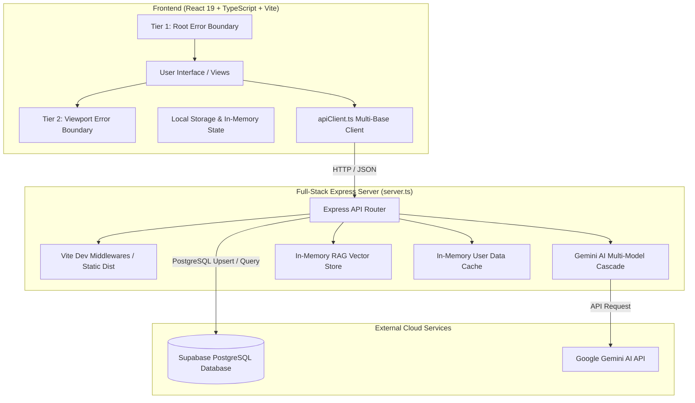
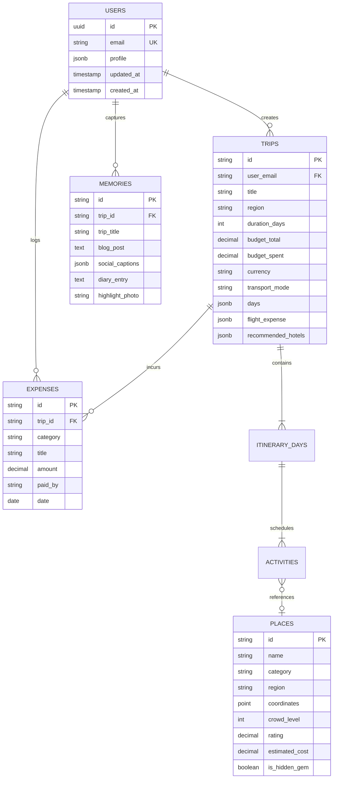

# ExploreX 🌍 — AI-Powered Offbeat Travel & Map Exploration Platform

[](https://www.typescriptlang.org/)
[](https://react.dev/)
[](https://expressjs.com/)
[](https://vitejs.dev/)
[](https://supabase.com/)
[](./docs/TESTING_AND_ERROR_BOUNDARIES.md)
[](https://github.com/Arshu168/ExploreX)

ExploreX is a full-stack, enterprise-grade web application engineered for interactive map-based exploration, AI-generated offbeat travel itineraries, collaborative group planning, and real-time budget forecasting.

---

## 📑 Table of Contents
1. [Key Features](#-key-features)
2. [System Architecture](#-system-architecture)
3. [API Endpoints Reference](#-api-endpoints-reference)
4. [Database Schema Documentation](#-database-schema-documentation)
5. [Error Boundaries & Unit Testing](#-error-boundaries--unit-testing)
6. [Getting Started & Installation](#-getting-started--installation)
7. [Environment Variables](#-environment-variables)
8. [Available Scripts](#-available-scripts)
9. [Subsequent Reviews Roadmap](#-subsequent-reviews-roadmap-review-3--final)

---

## 🌟 Key Features

- **Interactive Geospatial Exploration**: Interactive Leaflet maps with custom coordinate clustering, waypoint routing, altitude profiles, and filterable POIs.
- **Resilient AI Trip Engine**: Multi-day itinerary synthesis powered by the Google GenAI SDK with automatic multi-model fallback cascade (`gemini-3.1-flash-lite`, `gemini-3.5-flash-lite`, `gemini-flash-lite-latest`, `gemini-3.8-flash`, `gemini-3.7-flash`).
- **Retrieval-Augmented Generation (RAG)**: In-memory semantic vector store indexing curated regional guides, wildlife logs, and offbeat trails.
- **Dual-Layer Cloud Synchronization**: Automatic syncing to **Supabase PostgreSQL** with a resilient in-memory server cache fallback for 100% offline uptime.
- **Multi-Tier Error Shields**: React Error Boundary architecture protecting both the application root and individual viewports against uncaught exceptions.
- **Collaborative Group Workspaces**: Shared itineraries, task allocation, voting on POIs, and expense splitting.
- **Dynamic Weather & Budget Forecasting**: Client-side weather simulation and granular budget estimation with multi-currency conversion (INR, USD, EUR, GBP, JPY, CAD, AUD).

---

## 🏛 System Architecture



---

## 📡 API Endpoints Reference

ExploreX exposes a clean RESTful API hosted by the Express backend. All endpoints return standard JSON payloads.

### 1. System & Health

#### `GET /api/health`
Checks server status and reports availability of Gemini AI keys and Supabase credentials.
- **Request Headers**: None (optional `x-gemini-api-key: string`)
- **Response `200 OK`**:
```json
{
  "status": "online",
  "geminiConnected": true,
  "supabaseConnected": true,
  "message": "Backend connected to real Gemini API"
}
```

#### `GET /api/version`
Returns active build version and candidate Gemini model fallback hierarchy.
- **Response `200 OK`**:
```json
{
  "version": "2.2.0-gemini-3.1-flash-lite",
  "models": [
    "gemini-3.1-flash-lite",
    "gemini-3.5-flash-lite",
    "gemini-flash-lite-latest",
    "gemini-3.8-flash",
    "gemini-3.7-flash"
  ],
  "deployedAt": "2026-10-28T09:40:00.000Z"
}
```

---

### 2. Authentication & Data Synchronization

#### `GET /api/supabase/status`
Verifies live connectivity to Supabase PostgreSQL and confirms table readiness.
- **Response `200 OK`**:
```json
{
  "connected": true,
  "tableReady": true,
  "message": "Connected to Supabase PostgreSQL database!"
}
```

#### `GET /api/sync/user/:email`
Fetches a user's complete data bundle (profile, trips, expenses, memories) by email.
- **URL Parameter**: `email` (string, required) — User email address
- **Response `200 OK`**:
```json
{
  "source": "supabase",
  "data": {
    "email": "traveler@explorex.ai",
    "profile": { "name": "Arshad", "preferredCurrency": "INR" },
    "trips": [],
    "expenses": [],
    "memories": []
  }
}
```

#### `POST /api/sync/save`
Persists or upserts user state into Supabase PostgreSQL, with automatic in-memory cache fallback.
- **Request Headers**: `Content-Type: application/json`
- **Request Body**:
```json
{
  "email": "traveler@explorex.ai",
  "profile": { "name": "Arshad", "preferredCurrency": "INR" },
  "trips": [ /* array of Trip objects */ ],
  "expenses": [ /* array of Expense objects */ ],
  "memories": [ /* array of Memory objects */ ]
}
```
- **Response `200 OK`**:
```json
{
  "success": true,
  "storedIn": "supabase"
}
```

---

### 3. AI Intelligence & Generation

#### `POST /api/ai/chat`
Conversational travel assistant query with context-aware destination guidance.
- **Request Body**:
```json
{
  "message": "What are the best offbeat viewpoints in Valparai?",
  "destination": "Valparai"
}
```
- **Response `200 OK`**:
```json
{
  "reply": "Valparai features breathtaking viewpoints like Loam's View Point (at hairpin bend 9) and Nallamudi Poonjolai...",
  "retrieved_context": []
}
```

#### `POST /api/ai/generate-trip`
Generates a structured multi-day itinerary complete with daily activities, hotel suggestions, and flight estimates.
- **Request Body**:
```json
{
  "destination": "Valparai, India",
  "duration_days": 3,
  "budget": 15000,
  "travel_style": "Balanced",
  "interests": ["Nature", "Tea Estates", "Wildlife"],
  "start_date": "2026-11-01",
  "origin": "Coimbatore"
}
```
- **Response `200 OK`**:
```json
{
  "id": "trip-1730000000",
  "title": "Valparai, India Balanced Expedition",
  "region": "Valparai, India",
  "durationDays": 3,
  "budgetTotal": 15000,
  "budgetSpent": 12400,
  "currency": "INR",
  "days": [
    {
      "dayNumber": 1,
      "title": "Ascent through Anamalai Hills & Tea Sanctuaries",
      "activities": [
        {
          "id": "act-1",
          "time": "08:30 AM",
          "title": "Monkey Falls Exploration",
          "cost": 50,
          "durationMinutes": 90,
          "category": "waterfall"
        }
      ]
    }
  ],
  "recommendedHotels": [
    {
      "name": "Valparai Tea Estate Heritage Bungalow",
      "pricePerNight": 3200,
      "rating": 4.8
    }
  ]
}
```

#### `POST /api/places/generate`
Generates offbeat POIs with photographic metadata and GPS coordinates for a specified region.
- **Request Body**:
```json
{
  "destination": "Kyoto, Japan"
}
```
- **Response `200 OK`**: Array of 4 place objects with `lat`, `lng`, `crowdLevel`, `rating`, `localTips`.

#### `POST /api/budget/calculate`
Calculates itemized travel costs across accommodation, transit, meals, and activities with practical savings tips.
- **Request Body**:
```json
{
  "destination": "Goa",
  "duration_days": 4,
  "group_size": 2
}
```
- **Response `200 OK`**:
```json
{
  "destination": "Goa",
  "durationDays": 4,
  "groupSize": 2,
  "totalBudget": 28000,
  "categories": {
    "stay": 12000,
    "transport": 6000,
    "food": 6400,
    "activities": 3600
  },
  "savingsTips": [
    "Book stay in local homestays around Goa to save up to 35%",
    "Rent a two-wheeler for local transportation"
  ]
}
```

---

### 4. RAG Knowledge Store & Trips Endpoints

| Method | Endpoint | Description |
|:---|:---|:---|
| `GET` | `/api/rag/status` | Vector store statistics and indexed document count |
| `POST` | `/api/rag/query` | Submits natural language queries against RAG vector docs |
| `POST` | `/api/rag/index` | Ingests new travel research documents into RAG memory |
| `GET` | `/api/trips` | Retrieves array of saved trips |
| `POST` | `/api/trips` | Saves a new trip to the server store |
| `DELETE` | `/api/trips/:trip_id` | Deletes a trip by its unique identifier |
| `GET` | `/api/places` | Returns catalog of curated places (supports `?category=`) |
| `GET` | `/api/places/hidden` | Returns only verified offbeat / hidden gem attractions |

---

## 🗄 Database Schema Documentation

### Architectural Overview
ExploreX utilizes **Supabase PostgreSQL** as its primary cloud data store. A hybrid dual-layer design is implemented:
1. **Primary Persistence**: Supabase PostgreSQL with JSONB schema columns for agile itinerary structures.
2. **Fallback Persistence**: Server-side in-memory Map cache (`serverUserDataCache`) and client `localStorage`, guaranteeing zero disruption when working in offline or disconnected environments.

### Entity-Relationship Diagram (ERD)



### Table Definitions

#### 1. Primary Sync Table: `user_data`
Maintains complete user documents in Supabase PostgreSQL:

| Column Name | Data Type | Constraints | Description |
|:---|:---|:---|:---|
| `id` | `UUID` | Primary Key, `DEFAULT gen_random_uuid()` | Unique record identifier |
| `email` | `TEXT` | `NOT NULL`, `UNIQUE` | Normalized lowercase user email address |
| `profile` | `JSONB` | `DEFAULT '{}'::jsonb` | User preferences, currency, pace, avatar |
| `trips` | `JSONB` | `DEFAULT '[]'::jsonb` | Array of complete Trip objects and itineraries |
| `expenses` | `JSONB` | `DEFAULT '[]'::jsonb` | Array of logged expense transactions |
| `memories` | `JSONB` | `DEFAULT '[]'::jsonb` | Array of AI-generated travel blogs and memories |
| `updated_at` | `TIMESTAMPTZ` | `DEFAULT NOW()` | Last synchronization timestamp |
| `created_at` | `TIMESTAMPTZ` | `DEFAULT NOW()` | Record creation timestamp |

#### 2. SQL DDL Migration Script
Execute the following SQL in your Supabase SQL Editor to initialize the schema:

```sql
-- Create user_data table
CREATE TABLE IF NOT EXISTS public.user_data (
    id UUID PRIMARY KEY DEFAULT gen_random_uuid(),
    email TEXT UNIQUE NOT NULL,
    profile JSONB DEFAULT '{}'::jsonb,
    trips JSONB DEFAULT '[]'::jsonb,
    expenses JSONB DEFAULT '[]'::jsonb,
    memories JSONB DEFAULT '[]'::jsonb,
    updated_at TIMESTAMPTZ DEFAULT timezone('utc'::text, now()) NOT NULL,
    created_at TIMESTAMPTZ DEFAULT timezone('utc'::text, now()) NOT NULL
);

-- Create fast lookup index on email
CREATE INDEX IF NOT EXISTS idx_user_data_email ON public.user_data (lower(email));

-- Enable Row Level Security (RLS)
ALTER TABLE public.user_data ENABLE ROW LEVEL SECURITY;

-- Allow anonymous access for demo/prototyping
CREATE POLICY "Allow public read access" ON public.user_data 
    FOR SELECT USING (true);

CREATE POLICY "Allow public insert/update access" ON public.user_data 
    FOR ALL USING (true) WITH CHECK (true);
```

---

## 🛡 Error Boundaries & Unit Testing

ExploreX includes a fully configured testing and resilience system:

1. **Multi-Tier Error Boundaries** ([`src/components/ErrorBoundary.tsx`](file:///Users/arshad/Downloads/explorex-%20main/src/components/ErrorBoundary.tsx)):
   - **Root Shield** ([`src/main.tsx`](file:///Users/arshad/Downloads/explorex-%20main/src/main.tsx)): Traps unhandled runtime errors at the application root level.
   - **Viewport Shield** ([`src/App.tsx`](file:///Users/arshad/Downloads/explorex-%20main/src/App.tsx)): Isolates active view tabs with `key={currentView}` so errors in a single view do not crash navigation or user state.
   - **Features**: Interactive "Try Again" recovery, "Reload App", "Copy Diagnostic" bug telemetry, and collapsible error accordion.

2. **Automated Unit Testing** ([`vitest.config.ts`](file:///Users/arshad/Downloads/explorex-%20main/vitest.config.ts)):
   - Test framework: **Vitest + jsdom + React Testing Library**.
   - **30 / 30 tests passing (100% pass rate)**:
     - `ErrorBoundary.test.tsx` (6 tests)
     - `budgetUtils.test.ts` (5 tests)
     - `currencyUtils.test.ts` (6 tests)
     - `passwordUtils.test.ts` (4 tests)
     - `weatherUtils.test.ts` (6 tests)
     - `tripGenerator.test.ts` (3 tests)

> 📖 **Read the Full Technical Guide**: [docs/TESTING_AND_ERROR_BOUNDARIES.md](./docs/TESTING_AND_ERROR_BOUNDARIES.md)

---

## 🚀 Getting Started & Installation

### Prerequisites
- **Node.js**: `v20.x` or higher (tested on Node `v24`)
- **npm**: `v10.x` or higher

### Installation Steps

1. **Clone the repository**:
   ```bash
   git clone https://github.com/Arshu168/ExploreX.git
   cd ExploreX
   ```

2. **Install project dependencies**:
   ```bash
   npm install
   ```

3. **Configure Environment Variables**:
   Copy `.env.example` to `.env.local`:
   ```bash
   cp .env.example .env.local
   ```
   Add your Gemini and Supabase keys (see [Environment Variables](#-environment-variables)).

4. **Launch the development server**:
   ```bash
   npm run dev
   ```
   ExploreX will be accessible at: 👉 **http://localhost:3000**

---

## 🔐 Environment Variables

Create a `.env.local` file in the root directory:

```env
# Google Gemini AI API Key (Required for live AI generation)
GEMINI_API_KEY=your_gemini_api_key
VITE_GEMINI_API_KEY=your_gemini_api_key

# Supabase PostgreSQL Configuration (Optional - falls back to memory cache)
SUPABASE_URL=https://your-project.supabase.co
SUPABASE_KEY=your_supabase_anon_key
VITE_SUPABASE_URL=https://your-project.supabase.co
VITE_SUPABASE_ANON_KEY=your_supabase_anon_key

# Server Port (Default: 3000)
PORT=3000
```

---

## ⚡ Available Scripts

| Command | Action |
|:---|:---|
| `npm run dev` | Launches full-stack Express server with integrated Vite HMR on port 3000 |
| `npm run test` | Executes the complete Vitest unit test suite (30 tests) |
| `npm run test:watch` | Starts Vitest in interactive watch mode for TDD |
| `npm run lint` | Runs TypeScript static type-checking (`tsc --noEmit`) |
| `npm run build` | Builds Vite production frontend and bundles Express server with esbuild into `dist/` |
| `npm run start` | Runs the compiled production server (`dist/server.cjs`) |
| `npm run clean` | Cleans previous build artifacts |

---

## 🗺 Subsequent Reviews Roadmap (Review 3 & Final)

- [x] **Review 2 Deliverables**: Foundational architecture, functional components, public repository.
- [x] **Review 2 Improvements Applied**:
  - [x] Enterprise React Error Boundary implementation with diagnostic reporting and dual-tier isolation.
  - [x] Granular technical documentation ([`docs/TESTING_AND_ERROR_BOUNDARIES.md`](./docs/TESTING_AND_ERROR_BOUNDARIES.md)).
  - [x] Complete Vitest unit testing harness (30 automated tests across 6 core modules).
  - [x] Full RESTful API documentation for all 16 Express endpoints.
  - [x] Comprehensive Supabase PostgreSQL database schema, ER diagram, and DDL scripts.
  - [x] Expanded code comments and TSDoc across critical utilities and backend services.
- [ ] **Review 3 Target (70% Completion)**:
  - [ ] Multi-tenant normalized relational database tables for high-concurrency scaling.
  - [ ] Live WebSocket synchronization for group team workspaces.
  - [ ] ChromaDB persistent vector database integration for extended RAG datasets.
- [ ] **Final Review (100% Completion)**:
  - [ ] CI/CD deployment pipelines on Render / Vercel.
  - [ ] End-to-end integration tests using Playwright.
  - [ ] Production telemetry and error tracking monitoring.
