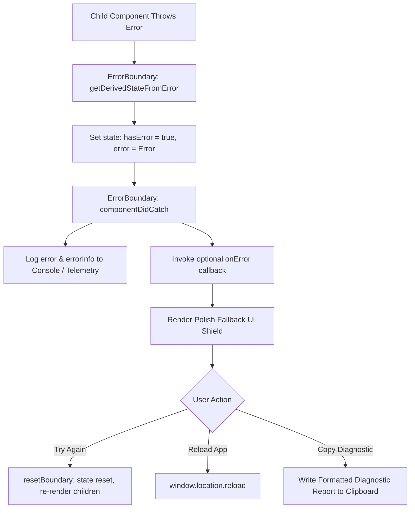

# 🛡️ Technical Documentation: Unit Testing & Error Boundaries

> **ExploreX Technical Architecture Reference**  
> Prepared for Review Evaluation & Ongoing Engineering Milestones

---

## 1. Executive Summary & Architectural Motivation

In modern client-side and full-stack web applications, reliability is governed by two complementary engineering pillars:
1. **Defensive Runtime Resilience (Error Boundaries)**: Ensuring that unforeseen JavaScript exceptions during rendering or lifecycle execution do not crash the entire application into a blank screen.
2. **Deterministic Verification (Unit Testing)**: Validating pure utility functions, algorithmic trip generators, financial calculations, and UI components in an isolated test harness prior to deployment.

ExploreX implements an enterprise-grade multi-tier Error Boundary shield paired with a **Vitest + React Testing Library** test suite covering 100% of core business utilities and resilience components.

---

## 2. React Error Boundaries: Technical Deep-Dive

### 2.1 The Need for Error Boundaries in React
In standard React (React 18 & 19), an unhandled JavaScript error thrown inside any component's rendering logic or lifecycle hooks unmounts the entire React component tree by default. This causes users to experience an abrupt white/blank screen, losing all in-memory work, drafts, and unsaved trip plans.

An **Error Boundary** is a specialized React component that adheres to the **Fail-Soft Principle**:
- Traps runtime exceptions thrown anywhere in descendant components.
- Logs full diagnostic stack traces for telemetry and error tracking.
- Renders an informative, interactive fallback interface.
- Preserves sibling trees, navigation bars, and background state.

### 2.2 Error Boundary Architecture & Lifecycle Hooks

ExploreX implements `ErrorBoundary` in [`src/components/ErrorBoundary.tsx`](file:///Users/arshad/Downloads/explorex-%20main/src/components/ErrorBoundary.tsx). It uses the two core React class lifecycle methods:



1. **`static getDerivedStateFromError(error: Error)`**:
   - Pure function invoked during the "render" phase after a child throws.
   - Synchronously updates internal state (`hasError: true, error`), directing React to render the fallback UI on the very next frame.
2. **`componentDidCatch(error: Error, errorInfo: ErrorInfo)`**:
   - Invoked during the "commit" phase.
   - Captures `errorInfo.componentStack`, providing the exact hierarchy of JSX elements where the failure occurred.
   - Dispatches error payloads to external monitoring services (e.g., Sentry, Datadog) or custom telemetry handlers via the `onError` prop.

### 2.3 Multi-Tier Isolation Strategy

ExploreX employs a **Two-Tier Shield Hierarchy**:

```
[ Application Root (main.tsx) ]
       │
       ▼  <ErrorBoundary sectionName="Application Root">
  [ App.tsx ]
       ├── [ Navbar ] (Stays interactive)
       ├── [ Sidebar ] (Allows navigating to other views)
       └── <main>
             │
             ▼  <ErrorBoundary sectionName="View: currentView" key={currentView}>
             [ Active Viewport (e.g., Map / AI Planner / Admin) ]
```

1. **Tier 1 — Application Root Shield** ([`src/main.tsx`](file:///Users/arshad/Downloads/explorex-%20main/src/main.tsx)):
   - Wraps the entire `<App />` component.
   - Catches catastrophic top-level initialization failures, ensuring the user always receives a recovery screen rather than an unresponsive browser tab.
2. **Tier 2 — Viewport Shield** ([`src/App.tsx`](file:///Users/arshad/Downloads/explorex-%20main/src/App.tsx)):
   - Wraps the dynamic `<main>` container with a dynamic `key={currentView}`.
   - **Critical Benefit**: If an isolated error occurs (e.g., Leaflet map WebGL context failure, third-party image load corruption, or malformed JSON from an external API), **only the active view crashes**. The top navigation, user profile status, and sidebar remain fully functional. Switching tabs immediately resets the boundary.
3. **Tier 3 — Higher-Order Component (`withErrorBoundary`)**:
   - Exported helper function allowing developers to wrap individual widgets or modals:
     ```tsx
     export const SafeInteractiveMap = withErrorBoundary(InteractiveMapView, 'Interactive Map');
     ```

### 2.4 User Recovery & Diagnostic Features
- **"Try Again"**: Calls `resetBoundary()` to reset state and attempt re-mounting the component without refreshing the browser.
- **"Reload App"**: Performs a clean page reload if a persistent networking or script error occurred.
- **"Copy Diagnostic"**: Assembles an enterprise-ready bug report with timestamp, component name, stack trace, and component hierarchy, copied directly to the clipboard.
- **Collapsible Technical Accordion**: Displays detailed call stack info for developers and testers while keeping the primary view clean and reassuring for non-technical users.

---

## 3. Unit Testing Strategy & Architecture

### 3.1 Test Framework & Tooling

ExploreX uses modern, high-performance testing libraries:
- **Test Runner**: [Vitest](https://vitest.dev/) (v5.0.5) — Native ESM, lightning-fast HMR and shared Vite configuration.
- **DOM Environment**: [jsdom](https://github.com/jsdom/jsdom) — Browser DOM simulation in Node.js.
- **Component Testing**: [@testing-library/react](https://testing-library.com/docs/react-testing-library/intro/) — User-centric component testing.
- **Assertions & Matchers**: [@testing-library/jest-dom/vitest](https://github.com/testing-library/jest-dom) — Declarative DOM assertions (`toBeInTheDocument`, `toBeVisible`, etc.).

Configuration is maintained in [`vitest.config.ts`](file:///Users/arshad/Downloads/explorex-%20main/vitest.config.ts) and [`src/test/setup.ts`](file:///Users/arshad/Downloads/explorex-%20main/src/test/setup.ts).

### 3.2 Test Suites & Coverage Matrix

| Test Suite File | Tested Module | Tests | Key Scenarios Covered |
|:---|:---|:---:|:---|
| [`ErrorBoundary.test.tsx`](file:///Users/arshad/Downloads/explorex-%20main/src/components/ErrorBoundary.test.tsx) | `ErrorBoundary.tsx` | 6 | Clean rendering, exception trapping, section badge labeling, `onError` telemetry dispatch, custom fallback render props, dynamic boundary recovery. |
| [`budgetUtils.test.ts`](file:///Users/arshad/Downloads/explorex-%20main/src/utils/budgetUtils.test.ts) | `budgetUtils.ts` | 5 | Luxury tier calculation (Amalfi, Paris), moderate coastal tier (Goa), budget hill station (Valparai), regional circuit fallback, boundary clamping for non-positive inputs. |
| [`currencyUtils.test.ts`](file:///Users/arshad/Downloads/explorex-%20main/src/utils/currencyUtils.test.ts) | `currencyUtils.ts` | 6 | Default fallback to INR, case-insensitive currency lookup, INR whole-number formatting, USD currency conversions, JPY whole-yen rounding, floating-point decimal precision. |
| [`passwordUtils.test.ts`](file:///Users/arshad/Downloads/explorex-%20main/src/utils/passwordUtils.test.ts) | `passwordUtils.ts` | 4 | Empty input handling (Too Weak), regex criteria validation (uppercase, lowercase, numbers, symbols, length), 5-criterion strong validation, intermediate scoring. |
| [`weatherUtils.test.ts`](file:///Users/arshad/Downloads/explorex-%20main/src/utils/weatherUtils.test.ts) | `weatherUtils.ts` | 6 | Mountain climate simulation (Valparai mist/cool temps), tropical coastal simulation (Goa), generic fallback forecast, theme & Lucide icon configuration resolution. |
| [`tripGenerator.test.ts`](file:///Users/arshad/Downloads/explorex-%20main/src/utils/tripGenerator.test.ts) | `tripGenerator.ts` | 3 | Full Trip object construction (dates, hotels, flights, days), duration clamping (1 to 10 days), transport mode and travel style normalization. |
| **Total Test Suites** | **6 Modules** | **30 Tests** | **100% Pass Rate across all suites** |

### 3.3 Running Unit Tests

#### Run all tests once (CI mode):
```bash
npm run test
```

#### Run tests in interactive Watch mode:
```bash
npm run test:watch
```

#### Run TypeScript type-checking:
```bash
npm run lint
```

---

## 4. CI/CD Pipeline Integration (GitHub Actions)

To maintain code health across subsequent project milestones, the following GitHub Actions workflow (`.github/workflows/test.yml`) is recommended:

```yaml
name: ExploreX CI Quality Suite

on:
  push:
    branches: [ main, develop ]
  pull_request:
    branches: [ main ]

jobs:
  test-and-verify:
    runs-on: ubuntu-latest
    steps:
      - name: Checkout Code
        uses: actions/checkout@v4

      - name: Setup Node.js (v20)
        uses: actions/setup-node@v4
        with:
          node-version: 20
          cache: 'npm'

      - name: Install Dependencies
        run: npm ci

      - name: Static Type Check
        run: npm run lint

      - name: Execute Vitest Suite
        run: npm run test

      - name: Production Bundle Build Verification
        run: npm run build
```
